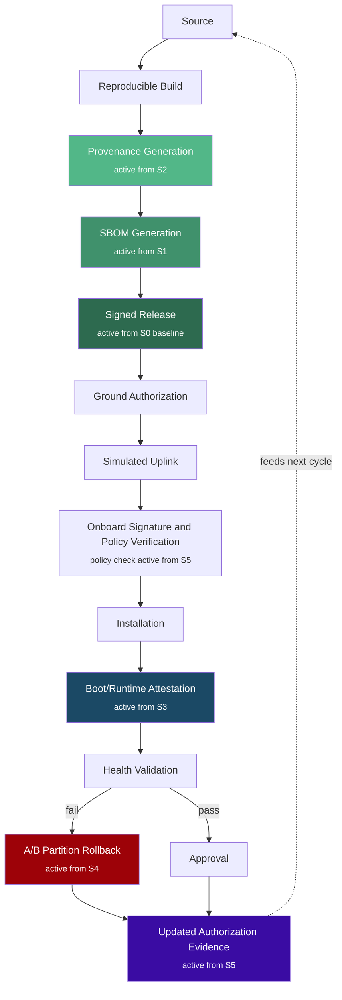
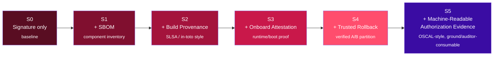
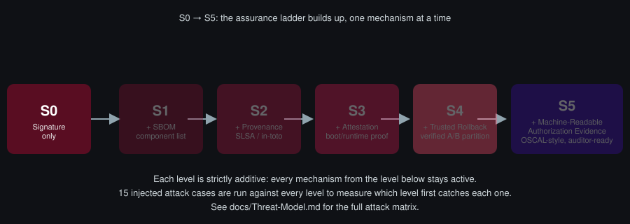
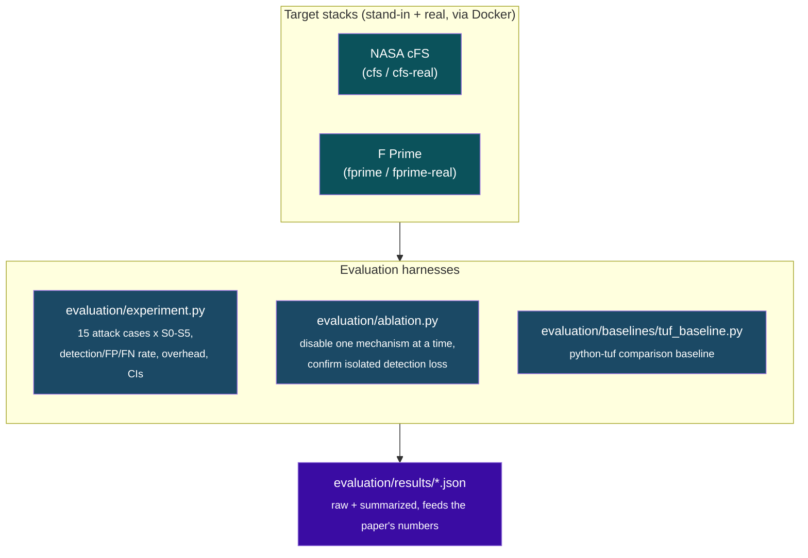

# Verifiable Spacecraft Software Lifecycle

Independent research project building and evaluating a controlled, end-to-end
verifiable software lifecycle pipeline for spacecraft flight software (NASA
Core Flight System / cFS), with the goal of producing a reproducible prototype
and a publishable comparative evaluation of software supply-chain assurance
levels (S0–S5).

## New here? Start with this

**First time cloning this repo to run or test it yourself?** Read
`docs/Getting-Started.md` — step-by-step instructions to install, run the
demo pipeline, run the test suite, and run the evaluation/ablation
harnesses. No prior context needed. Or, for the fastest possible path to
seeing it work, copy-paste the block below.

### Quick start (copy-paste, ~2 minutes, no Docker required)

```bash
git clone https://github.com/Zartharas/verifiable-spacecraft-lifecycle.git
cd verifiable-spacecraft-lifecycle
python3 -m venv .venv && source .venv/bin/activate   # Windows: .venv\Scripts\activate
pip install -r requirements-dev.txt

# 1. Run the demo pipeline (five end-to-end calls, incl. a caught tamper attack)
python3 src/pipeline.py

# 2. Run the full test suite (197 tests: every attack case x every assurance level, plus regression and mutation tests)
python3 -m pytest -q

# 3. Run the statistical evaluation that produces the paper's numbers
python3 evaluation/experiment.py

# 4. Run the mechanism-isolation ablation study
python3 evaluation/ablation.py
```

Everything above runs against a fast, local stand-in binary — no Docker,
no NASA source download, nothing beyond Python 3.10+. Running against the
*real* NASA cFS/F´ frameworks via Docker is optional and covered in
`docs/Getting-Started.md` § 6. Full explanations, expected output, and
troubleshooting for every command above: `docs/Getting-Started.md`.

## How it works



Twelve stages, one artifact lifecycle, six increasingly strict assurance
levels layered on top of the same pipeline. See
`docs/Pipeline-Flow-Document.md` for the full per-stage actor/input/output/
evidence breakdown.

### The S0–S5 assurance ladder

Each level is strictly additive — every mechanism from the level below
stays active:



Fifteen injected attack cases run against every level; the evaluation
harness measures which level first catches each one. See
`docs/Threat-Model.md` for the full attack matrix.

<p align="center">
  
</p>

### Evaluation architecture



## Who the rest of this document is for

This repo is maintained by a single independent researcher. The documents
below exist so that both the researcher and any AI assistant (Claude) picking
the project back up mid-stream can reconstruct full context without
re-deriving decisions already made. Read `STATUS.md` first in every new
session.

## Document index

Read in this order when resuming work:

1. **STATUS.md** — current state, what's done, what's next, open blockers. Read this first, always.
2. **docs/Getting-Started.md** — for a human running/testing this for the first time (see above).
3. **docs/PRD.md** — what we're building and why, scope, success criteria.
4. **docs/Threat-Model.md** — the S0–S5 assurance ladder and the attack/test matrix that drives everything else, including all independent red-team review findings.
5. **docs/Pipeline-Flow-Document.md** — the end-to-end lifecycle flow (source → rollback), actors, data flow.
6. **docs/Technical-Design-Document.md** — architecture, components, tech stack, schemas.
7. **docs/Implementation-Plan.md** — phased build plan, milestones, task breakdown.
8. **docs/Research-Paper-Outline.md** — how the prototype's results map to a paper, venue targets.
9. **docs/Legal-Data-Sourcing-Notes.md** — what data/software sources are used and why they're legally clean for an independent researcher.
10. **docs/Paper-Draft.md** — the manuscript itself: full text, citation-verification history, and target-venue status.
11. **ISSUES-AND-FIXES-LOG.md** — every bug and security finding, root cause, fix, and disclosure status.
12. **SECURITY.md** — responsible disclosure policy for this repo.

## Project structure

```
verifiable-spacecraft-lifecycle/       # repo root
├── README.md                          # this file
├── STATUS.md                          # living progress tracker — update every session
├── SECURITY.md                        # responsible disclosure policy
├── ISSUES-AND-FIXES-LOG.md            # bug/security fix ledger
├── docs/
│   ├── Getting-Started.md             # start here if you're new
│   ├── PRD.md
│   ├── Threat-Model.md
│   ├── Pipeline-Flow-Document.md
│   ├── Technical-Design-Document.md
│   ├── Implementation-Plan.md
│   ├── Research-Paper-Outline.md
│   ├── Legal-Data-Sourcing-Notes.md
│   ├── Paper-Draft.md                 # the manuscript itself
│   └── assets/                        # diagrams/animations used in this README
├── src/                                # pipeline code: build, signing, ground
│   │                                     authorization, uplink sim, onboard
│   │                                     verification, installation,
│   │                                     attestation, rollback, policy, SBOM,
│   │                                     provenance, evidence store
├── cfs-app/, fprime-app/               # target applications under test
│                                         (stand-in stubs by default; real
│                                         NASA cFS/F´ via Docker, optional)
├── tests/                              # attack/tamper injection + regression suite
└── evaluation/                        # experiment runner, metrics, ablation study
```

## Status

See `STATUS.md` for the current phase and detailed session log. In short:
the full S0–S5 pipeline is built and tested (197 tests passing), evaluated
against two target stacks (NASA cFS and F´, both stand-in and real Docker
builds) with a full statistical evaluation and mechanism-isolation ablation
study, and has been through four rounds of independent, blind, AI-driven
red-team review (Claude, OpenAI, Zhipu AI's GLM, and DeepSeek) — see
`docs/Threat-Model.md` and `ISSUES-AND-FIXES-LOG.md` for every finding and
fix. The companion paper (`docs/Paper-Draft.md`) has been submitted for
peer review; a human-colleague code review remains separately pending.
The repo is expected to go public no later than the paper's publication
date.

## License

Apache License 2.0 (see `LICENSE`) — matches cFS's own license and includes
an explicit patent grant, appropriate for research code composing multiple
licensed components.
