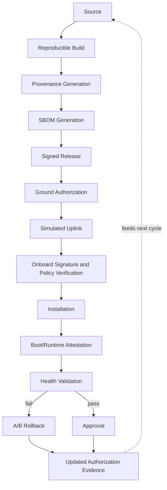

# Pipeline Flow Document

**Last updated:** 2026-08-02
**Status:** Draft v1

This is the "App Flow" equivalent for a pipeline/systems project — it
describes the end-to-end lifecycle flow an artifact moves through, the
actors at each stage, and what data/evidence is produced and consumed.

## 1. Lifecycle overview

```
Source
  → Reproducible Build
    → Provenance Generation
      → SBOM Generation
        → Signed Release
          → Ground Authorization
            → Simulated Uplink
              → Onboard Signature & Policy Verification
                → Installation
                  → Boot/Runtime Attestation
                    → Health Validation
                      → [A/B Partition Rollback  OR  Approval]
                        → Updated Authorization Evidence
```

Each arrow represents a transition where evidence is produced, checked, or
both, depending on the active assurance condition (S0–S5, see
Threat-Model.md).

## 2. Actors

| Actor | Role |
|---|---|
| Developer (researcher) | Commits source, triggers builds |
| Build system | Produces reproducible binary + provenance |
| SBOM generator | Produces component inventory |
| Signing authority | Signs the release artifact |
| Ground authorization service | Simulated mission ops function — approves/denies release for uplink based on policy |
| Uplink simulator | Simulates ground-to-spacecraft transmission with configurable latency/loss (CCSDS-informed) |
| Onboard verification agent | Simulated flight software component — checks signature, policy, provenance before install |
| Onboard attestation agent | Produces boot/runtime attestation evidence |
| Health monitor | Validates post-install operational health |
| Rollback controller | Manages A/B partition state, triggers rollback on failure |
| Evidence store | Machine-readable log of all evidence across the lifecycle (used for S5 and for metrics collection) |

In the prototype, most "actors" are simulated services/scripts running
locally or in containers — there is no real ground station or real
spacecraft. See Legal-Data-Sourcing-Notes.md for why this is both
sufficient and necessary.

## 3. Stage-by-stage detail

### 3.1 Source
Input: developer commit to version-controlled source repo (the cFS
application under test).
Output: a specific, tagged commit hash.

### 3.2 Reproducible Build
Input: source commit.
Output: binary artifact + build log, built in a defined, reproducible
environment (pinned toolchain, pinned dependencies) such that re-running
the build from the same source produces a bit-identical binary.
Evidence produced: build environment descriptor, build log.

### 3.3 Provenance Generation
Input: build output + build environment descriptor.
Output: a provenance attestation (SLSA/in-toto style) linking binary →
source commit → build environment → build runner identity.
Active from: S2.

### 3.4 SBOM Generation
Input: build output/dependency graph.
Output: CycloneDX or SPDX SBOM listing all components/dependencies with
versions.
Active from: S1.

### 3.5 Signed Release
Input: binary + provenance + SBOM (whichever are active for the condition).
Output: a signed release bundle (signature over the binary, or over the
binary+provenance+SBOM bundle depending on condition).
Active from: S0 (signature always present — it's the baseline).

### 3.6 Ground Authorization
Input: signed release bundle.
Output: an authorization decision (approve/deny) based on policy (e.g., is
this configuration permitted, is the signer's key currently valid/not
revoked).
Active policy checks scale with condition — S5 requires this decision
itself to be recorded as machine-readable evidence.

### 3.7 Simulated Uplink
Input: authorized release bundle.
Output: bundle as received on the "spacecraft" side, after passing through
a link model with configurable latency, loss, and bandwidth ceiling
(CCSDS-informed, not RF-accurate — see PRD.md non-goals).
This is also where in-transit tampering test cases are injected (attack
matrix test case #6).

### 3.8 Onboard Signature & Policy Verification
Input: received bundle.
Output: accept/reject decision. Checks signature validity (and revocation
status where modeled), and — from S5 — checks against machine-readable
policy for prohibited configurations.

### 3.9 Installation
Input: verified bundle.
Output: installed artifact on the inactive partition (A/B scheme, active
from S4) or in place (earlier conditions, simpler model).
Interruption/failure test cases injected here (#10).

### 3.10 Boot/Runtime Attestation
Input: installed artifact + boot state.
Output: attestation evidence (active from S3) proving the system booted
the expected, verified artifact.

### 3.11 Health Validation
Input: post-boot runtime state.
Output: pass/fail health signal. Failure triggers rollback (from S4).

### 3.12 A/B Partition Rollback or Approval
On health failure (or attestation failure, or operator-triggered rollback):
revert to the last-known-good partition (active from S4). On success:
the new version becomes the active, approved baseline.

### 3.13 Updated Authorization Evidence
Final step: the evidence store is updated to reflect the new authorized
state — binary version, attestation status, health status — in
machine-readable form (from S5), closing the loop for the next lifecycle
iteration.

## 4. Data flow / evidence chain

Every stage that produces evidence writes to a central, append-only
evidence store (a simple structured log for the prototype — e.g.,
JSON/OSCAL-formatted records). This store is what the "traceability
completeness" and "manual evidence-processing effort" metrics are computed
against. See Technical-Design-Document.md for the schema.

## 5. Diagram (Mermaid — render in any Markdown viewer that supports it)


